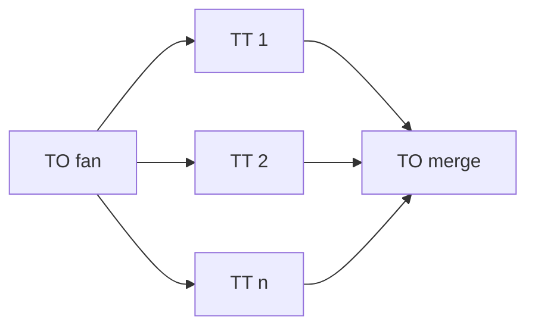

# Atom theory (why the primitives are what they are)

> **Hot path:** [agent-topologies.md](agent-topologies.md) ·
> [compounds.md](compounds.md). This doc is secondary rationale.
>
> **Read §§1–2 + Summary** for the model. **§§3–5 are deep reference** (star
> optimality, reduction trees, flat vs tree merge) — skip unless you need that
> depth.
>
> **Public surface:** atoms `swarm|plane|cove|shard`; combinator `cycle`;
> transition `revise`; prefer named compounds. The public menu is the registry.

---

## 1. There is only one topology

The four atoms are **not** four topologies. Structurally they are identical:
one topic, N orthogonal splits, N blind workers, one merge. The shape never
varies.

```
fan(partition, worker, merge)
```

`fan` is the **genus**. The atoms are **species**, individuated by their
**merge algebra** — not by their shape and not by the kind of thing they split.

> **"Atomic topologies" is a misnomer.** There is one topology and four typed
> merges. The name implies a structural difference that does not exist.

This is good news for the runtime: there is exactly one primitive to implement,
and all variation lives in typed policy.

### Why `plane` is not the universal

A recurring and reasonable challenge: *"aren't these all planes with different
kinds of lens — a question, a claim, a piece of code?"*

The fan shape is genuinely shared, but `plane` is the species whose merge is
**conjunction**. Promoting it to the universal imports AND-gate semantics that
break the others. Two discriminators show this.

**Discriminator 1 — what does a negative result mean?**

| Atom | One worker returns nothing / a negative | Merge fails even when *every* worker succeeded? |
| :--- | :--- | :--- |
| `swarm` | brief is thinner, still valid | no |
| `plane` | **the whole audit fails** — it is a gate | no |
| `cove` | that is a REFUTED — a *successful* outcome | no |
| `shard` | assembly fails | **yes** — signature drift, duplicate symbol |

Under plane semantics a refuted claim would fail the cove. But a refuted claim
is precisely what the cove was run to find. Same event, three different
meanings — that is the merge algebra showing through.

The right-hand column is unexplainable by any arrangement of lenses. `shard` is
the only atom whose merge is a **partial function**: N workers can each succeed
at their own piece and assembly still fails.

**Discriminator 2 — views of the subject, or parts of it?**

| Atom | Subject exists before the fan? | The N things are | Separated from its pair by |
| :--- | :--- | :--- | :--- |
| `plane` | yes — the artifact | views | merges to **one** verdict (AND) |
| `cove` | yes — the draft | views | merges to **N** verdicts (a table) |
| `swarm` | no — the answer does not exist yet | constitutive | no contract; merge is total |
| `shard` | no — the artifact does not exist yet | constitutive | contract required; merge is partial |

A "lens" is a *view*. Half these atoms are not views, they are **parts** — which
is why the lens generalization cannot cover them.

---

## 2. Graph classification

Two graphs are in play.

**Spawn graph** — a rooted tree of depth <= 2: Main -> TOs (flat, no TO-to-TO)
-> TTs (leaves, never spawn). Each atom is a star centered on its TO.

**Dataflow graph** — unroll one atom in time and you get
`TO -> {TT_1 .. TT_n} -> TO`, a diamond. That is **fork-join**, the canonical
split/merge pattern from parallel computing. Sequence those diamonds and you get
a **series-parallel graph**: parallel composition inside an atom, series
composition between atoms.



### The forbidden subgraph is already your invariant

Series-parallel DAGs are exactly those containing no induced **"N"**: nodes
where `a -> c`, `b -> c`, `b -> d`, but no `a -> d`.

Concretely an N means *one worker's output feeding two different merges, one of
which also draws from elsewhere*. That is precisely what "each TT has one
parent, TTs do not talk to each other" forbids.

**The existing control-plane invariants and the series-parallel restriction are
the same constraint stated two ways.** This was not designed in deliberately; it
falls out.

### Structured concurrency

The primitives are sequence (compound wiring), fan (the atom), and iteration
(the `cycle` combinator). That is the parallel analogue of Bohm-Jacopini's
sequence / selection / iteration.

Selection (branch on evidence) remains a TO judgment in compound wiring — it is
not a separate public combinator.

---

## Summary of the model

```
atoms        swarm | plane | cove | shard         (closed, fail-closed)
transitions  revise                               (closed, fail-closed)
combinators  cycle                                (closed, fail-closed)
composition  freeform DAG over the above          (open)
```

Public / prompt surface = the registry above; prefer named compounds.

- An **atom** partitions by content and keeps every output.
- Anything that runs the same task N times and discards some is a **combinator**.
- A **transition** mutates the atom's subject between cycle rounds.
- The atom is **fixed for the lifetime of a cycle**; changing it starts a new
  cycle.
- `accept` and `bound` belong to the **cycle**, not the atom.

---

## Deep reference (§§3–5)

> Optional depth. Not required for routing or day-to-day compound design.

### 3. Why the star is near-optimal (given LLM economics)

The star is not an accident, but the reasons are not the classic network-topology
ones. **LLM economics invert the assumptions classic network topology is built
on.**

**Edges cost context, not bandwidth.** In a datacenter, wires are cheap and a
mesh's O(n^2) links buy diameter 1. Here every edge is tokens that must be read
into a context window. A mesh where each of n workers reads the other n-1 costs
O(n^2) tokens. At n=6 that is 36 message-reads versus the star's 6 — a 6x
multiplier on the scarcest resource, for identical work.

**A hop is a model call, measured in seconds.** Ring and chain topologies are
fine when a hop is microseconds. Here, propagating information around a ring is
O(n) *sequential model calls*. The star does its entire fan in one parallel
round.

**Redundant paths create correlation, not robustness.** This one has no analogue
in network theory and it is the deepest. In networks, extra paths mean fault
tolerance — which is why a star's single hub is considered a weakness. In agent
systems, extra paths between workers mean they see each other's reasoning,
converge, and anchor. That destroys the independence that makes a cove's
verdicts or a plane's lanes worth anything.

> The property classic theory calls the star's flaw — single point of failure,
> hub bottleneck — is the same property agent design calls its virtue: single
> point of synthesis, structurally enforced independence, one auditable
> observation point.

| Topology | Rounds (model calls) | Token cost | Independence | Verdict |
| :--- | :--- | :--- | :--- | :--- |
| Star | O(1) | O(n) | preserved | what we use |
| Full mesh | O(1) | **O(n^2)** | destroyed | strictly worse |
| Ring / chain | **O(n)** | O(n) | partial | latency-fatal |
| Bus | O(1) | O(n^2) read | destroyed | mesh with extra steps |
| Reduction tree | O(log n) | ~2x flat | preserved | feasibility tool, see below |

**Not applicable:** pipeline/systolic (agent calls are coarse and few — nothing
to overlap), gossip/epidemic (exists to avoid a hub; we *want* the hub for
audit), hypercube/butterfly (optimizes all-to-all, which we never need).

Perfect graphs do not apply — nothing here is naturally a colouring problem. The
one genuine colouring connection is adjacent: assigning models/providers to
concurrent TTs under rate limits is colouring on the conflict graph, where a
single fan against one provider is K_n, so chromatic number = n. That is just
the formal way of saying fan-out is bounded by provider capacity.

### 4. Reduction trees: a feasibility mechanism, not an efficiency one

The one place another architecture genuinely earns its keep.

**The hub bottleneck is a context-window limit.** A cove with 20 claims requires
the TO to read 20 verdicts and reconcile them in one context. That does not
degrade gracefully; it degrades into the TO skimming.

The fix from parallel computing is to replace the single n-to-1 merge with a
**balanced reduction tree**: merge pairs, then merge the pairs. You get O(log n)
merge depth with bounded context at every merger, and independence survives
because intermediate mergers are blind to each other's subtrees.

**But be precise about the cost.** A binary tree has n-1 internal merge calls,
and intermediate summaries are re-read at each level, so total tokens run
roughly **2x the flat merge** across **log n serial rounds** instead of one call.

> A reduction tree is not an efficiency mechanism. Reach for it when n outputs
> will not fit one context or when per-item attention has visibly degraded, and
> accept that you pay more tokens and more latency for feasibility.

It also collides with the depth-2 invariant, since intermediate mergers are
neither TOs nor leaf TTs. **Not implemented.** Documented so the trade-off is
known when large fans force the question.

### 5. Flat merge vs tree merge: what actually differs

A fold is *already* happening — the TO reading n outputs and writing a brief is
a reduce. The question is whether it happens flat over the whole multiset in one
context, or hierarchically through intermediate compressions.

#### The formal requirement fails in practice

Tree reduction equals flat reduction only if the merge is associative. All four
algebras qualify on paper — union, conjunction, and per-claim adjudication are
associative and commutative; assembly is too, given a fixed upfront contract.

**The implementations are not.** A model summarizing (A,B) then summarizing that
with C does not produce what it would from (A,B,C) in one pass. Every
intermediate node is a lossy compression. The algebra promises
interchangeability and the executor breaks it.

#### The trade-off

**Flat preserves cross-cutting relations.** Some findings exist only *between*
distant leaves — scout 1 and scout 7 each report something unremarkable, but
together they contradict. Flat has both in view. A tree pairing (1,2) and (7,8)
compresses each before they ever meet. Worse, the pairing order is arbitrary:
you impose a locality structure carrying no semantic meaning.

**But flat's "global view" is partly fiction.** Long-context attention is
uneven; the lost-in-the-middle effect means a merge over 20 verdicts genuinely
does attend poorly to items 8-14. A tree gives every leaf *uniform* attention,
because each merger sees only a handful.

> Flat buys global relation-detection at the cost of degrading per-item
> attention. Tree buys uniform per-item attention at the cost of destroying
> cross-cutting relations. The crossover depends on n and on whether the value
> lives in the items or in the relations between them.

#### Which predicts where tree reduction is safe

| Atom | Merge kind | Tree-safe? | Why |
| :--- | :--- | :--- | :--- |
| `cove` | per-claim verdicts | **yes** | claims are independent by construction; it is a map, not really a fold. Also the atom most likely to hit context pressure — the place needing the fix is the place it costs nothing |
| `plane` | conjunction | **yes** | ANDing booleans with evidence pointers; mechanical and genuinely associative |
| `shard` | assembly | **yes** | integration failures are local and checkable; pairwise linking is how linkers already work |
| `swarm` | synthesis | **no** | synthesis is *entirely* about cross-cutting relations; this is the classic failure mode of naive map-reduce over research |

If a reduction tree is ever built: **pair semantically, not arbitrarily.**
Clustering related findings before reducing preserves the relations that matter
within a cluster and sacrifices only cross-cluster relations — a far better
trade than random pairing, which sacrifices relations uniformly at random.
